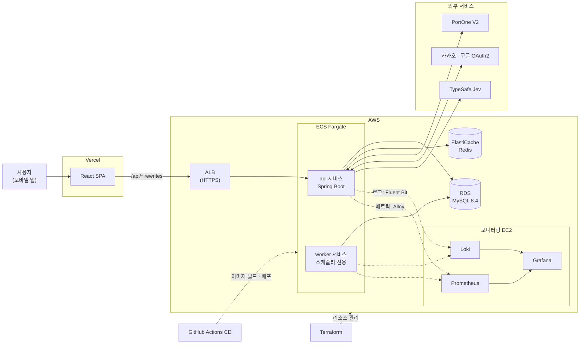

# 놀이동선

**타고 싶은 어트랙션을 고르면, 덜 걷는 순서로 추천하고 한 번에 예약까지.**

놀이공원 어트랙션 예약 · 최적 루트 추천 서비스

[프로젝트 소개](#-프로젝트-소개) · [주요 기능](#-주요-기능) · [저장소](#-저장소) · [기술 스택](#-기술-스택) · [아키텍처](#-아키텍처) · [트러블슈팅](#-기술적-도전--트러블슈팅) · [문서](#-문서-모음) · [팀원](#-팀원)

---

## 🎡 프로젝트 소개

> 이 저장소는 **백엔드(Spring Boot API 서버)** 입니다. 화면 코드는 [프론트엔드 저장소](https://github.com/attraction-final/attraction-reservation-frontend)에 있습니다.

놀이공원에서는 인기 어트랙션의 **긴 대기 시간**, **예약 경쟁**, **복잡한 이동 동선** 때문에 원하는 만큼 즐기지 못하는 경우가 많습니다.

**놀이동선**은 에버랜드를 기반으로 만든 서비스입니다. 타고 싶은 어트랙션을 고르면 **현재 위치와 이동 거리를 고려한 방문 순서**를 추천하고, **시간대별 슬롯 예약**까지 한 번에 할 수 있습니다.

| 항목 | 내용 |
|---|---|
| 기간 | 5주 |
| 사용자 | 놀이공원 방문객 |
| 관리자 | 어트랙션 · 운영 일정 · 예약 현황을 관리하는 운영자 |
| 화면 | 모바일 웹 (PC에서는 휴대폰 틀 안에 표시) |

---

## ✨ 주요 기능

| | 기능 | 한 줄 설명 |
|:---:|---|---|
| 🗺 | **루트 추천 · 일괄 예약** | 카카오맵에서 어트랙션을 최대 5개 고르면 걷는 시간이 가장 짧은 방문 순서를 추천합니다. 추천 결과는 한 번에 예약하며, 하나라도 실패하면 모두 취소됩니다. |
| ⏰ | **슬롯 예약** | 시간대(슬롯)를 골라 예약합니다. 정원, 마감 시각, 내 다른 예약과의 시간 겹침을 검사합니다. |
| 🎫 | **입장권 구매 · 환불** | PortOne V2로 결제하고, 입장권을 QR 코드로 보여 줍니다. 한 장 단위로 환불할 수 있습니다. |
| 💬 | **어트랙션 Q&A** | 자연어로 질문하면 AI는 어트랙션과 질문 의도만 분류하고, 답의 숫자는 DB에서 가져옵니다. |
| 🔐 | **회원 · 인증** | 이메일 가입과 카카오 · 구글 소셜 로그인, JWT(Access + Refresh) 인증을 지원합니다. |
| 🛠 | **관리자** | 어트랙션 · 슬롯 · 입장권 상품 · 주문 · 예약 · 회원을 관리하고, QR 스캔으로 입장을 처리합니다. |

> 화면별 상세 기능은 [프론트엔드 README](https://github.com/attraction-final/attraction-reservation-frontend#-주요-기능)에서 볼 수 있습니다.

---

## 📦 저장소

| 저장소 | 내용 | 바로가기 |
|---|---|---|
| 🖥 **[attraction-reservation-frontend](https://github.com/attraction-final/attraction-reservation-frontend)** | React + Vite 모바일 웹 · Vercel 배포 | [README](https://github.com/attraction-final/attraction-reservation-frontend#readme) · [개발 가이드](https://github.com/attraction-final/attraction-reservation-frontend/blob/main/DEVELOPMENT.md) · [API 목록](https://github.com/attraction-final/attraction-reservation-frontend/blob/main/docs/api.md) |
| ⚙️ **[attraction-reservation](https://github.com/attraction-final/attraction-reservation)** | Spring Boot API 서버 · AWS ECS Fargate 배포 | [docs 폴더](docs) · [비즈니스 규칙](https://github.com/attraction-final/attraction-reservation/blob/main/docs/business-rules.md) · [ERD](docs/images/erd.png) |

---

## 🛠 기술 스택

| 분류 | 기술 |
|---|---|
| **Backend** |       |
| **Data** |   |
| **Frontend** |     |
| **Infra · CI/CD** |       |
| **Monitoring** |     |
| **Test** |    |

| 외부 연동 | 용도 |
|---|---|
| PortOne V2 | 입장권 결제 · 환불, 결제 웹훅 |
| Kakao Maps | 루트 추천 지도 |
| 카카오 · 구글 OAuth2 | 소셜 로그인 |
| TypeSafe Jev | 어트랙션 Q&A의 질문 의도 분류 |

---

## 🏗 아키텍처

| 구성 | 설명 |
|---|---|
| 프론트 | Vercel이 SPA를 내려 주고, `/api/*` 요청은 rewrites로 백엔드에 전달합니다. |
| 앱 | 같은 이미지를 **api**(사용자 요청)와 **worker**(스케줄러) 두 서비스로 나눠, 스케줄러가 여러 task에서 겹쳐 돌지 않게 했습니다. |
| 관측 | 각 task의 Fluent Bit이 로그를 Loki로, Alloy가 메트릭을 Prometheus로 보내고 Grafana에서 봅니다. |
| 배포 | AWS 리소스는 Terraform으로 관리하고, `main` 머지 시 GitHub Actions CD가 바뀐 대상(앱 / 모니터링)만 배포합니다. |

> 자세한 구성은 [운영 배포 구성](docs/infra/deployment.md) · [EC2 → ECS Fargate 전환 ADR](docs/infra/ecs-migration-rationale.md)에서 볼 수 있습니다.

---

## 🔥 기술적 도전 · 트러블슈팅

### 🗺 최적 경로 추천

> 고른 어트랙션(최대 5개)을 **슬롯 시간 안에서 가장 많이, 가장 빨리** 도는 순서를 찾고, 그 결과를 한 번에 예약합니다.
> 전체 목록: [경로 추천 기술 결정](docs/technical-decisions/route-recommendation.md)

| 분류 | 주제 | 핵심 | 문서 |
|---|---|---|---|
| 기술적 도전 | 시간 제약이 있는 방문 순서 탐색 | 가장 이른 슬롯부터 고르는 그리디는 2곳 갈 수 있는 경우에 1곳만 찾습니다. **DFS + 백트래킹 완전 탐색**(최대 326개 노드)으로 최적을 보장하고, 4단계 비교 기준으로 결과를 항상 같게 했습니다. | [완전 탐색](docs/technical-decisions/route-search-dfs-backtracking.md) |
| 기술적 도전 | 슬롯 조합 폭발 막기 | 순서가 정해지면 "도착 후 가장 이른 슬롯"이 항상 최선임을 이용해, 탐색 공간을 `순열 × 40⁵`에서 `순열`로 줄였습니다. | [슬롯 고정](docs/technical-decisions/route-slot-earliest-after-arrival.md) |
| 기술적 도전 | 외부 API 없이 첫 구간 추정 | 현재 위치 → 첫 어트랙션은 **하버사인 직선거리 × 우회 계수 1.68 ÷ 보행 속도 52.8m/분**으로 추정합니다. 두 값은 실측 구간 90건의 중앙값입니다. | [첫 구간 추정](docs/technical-decisions/route-start-leg-haversine.md) |
| 트러블슈팅 | 첫 구간 올림의 부동소수점 함정 | `ceil`이 1 큰 값을 줄 수 있다는 의심을 전수 계산으로 확인했습니다. 기본값에서는 0건, 설정값을 1.34 · 45.3으로 바꾸면 발생합니다. 이중 올림은 0.767%에서 +1분으로, 안전한 방향이라 받아들였습니다. | [올림 · 부동소수점 점검](docs/troubleshooting/route-start-leg-estimation.md) |
| 데이터 정합성 | 방향별 실측 구간만 사용 | A→B와 B→A의 실측 시간이 다릅니다. 없는 구간을 역방향 값이나 추정값으로 채우지 않고, 그 순서를 버립니다. | [방향별 실측 구간](docs/technical-decisions/route-directional-measured-paths.md) |
| 데이터 정합성 | 위치 검증과 서비스 지역 | 위치 오차 100m 이상, 가장 가까운 어트랙션까지 2,000m 밖은 탐색 전에 거부합니다. 5분 넘은 위치는 막지 않고 경고만 붙입니다. | [위치 검증](docs/technical-decisions/route-location-validation.md) |
| 데이터 정합성 · 동시성 | 일괄 예약 all-or-nothing + 교착 방지 | 한 곳이라도 실패하면 정원 차감까지 모두 롤백합니다. **어트랙션 ID 순서로 잠금**을 잡아, 방문 순서가 엇갈린 동시 일괄 예약도 교착 없이 처리됩니다(동시성 통합 테스트 4종). | [일괄 예약 잠금 순서](docs/technical-decisions/route-bulk-reservation-lock-order.md) |
| 성능 · 조회 최적화 | 탐색 중 DB 조회 0회 | 선택한 어트랙션 간 구간을 **쿼리 1번**(최대 20행)으로 읽어 메모리 조회표로 탐색합니다. 알고리즘이 JPA에 의존하지 않아 순수 단위 테스트로 검증합니다. | [구간 쿼리 1번](docs/technical-decisions/route-travel-time-single-query.md) |

### 💬 어트랙션 Q&A (Jev AI)

> 자연어 질문을 AI로 분류하되, **답의 숫자는 DB에서만** 나오게 했습니다.
> 전체 목록: [Jev Q&A 기술 결정](docs/technical-decisions/attraction-qna-jev.md) · [테스트 시나리오 20개](docs/requirements/attraction-qna-scenarios.md)

| 분류 | 주제 | 핵심 | 문서 |
|---|---|---|---|
| 기술적 도전 | 생성형 AI의 잘못된 수치 차단 | Jev는 "어느 어트랙션의 무엇을 묻는지"만 선택지로 고릅니다. 키 제한 · 운영 시간 · 상태 문장은 DB 값으로 조립합니다. | [분류만 하는 AI](docs/technical-decisions/attraction-qna-classify-only.md) |
| 기술적 도전 | 확신도 기반 판정 | 확신도 0.6을 기준으로 답변 · 요약 · 되묻기 · 미지원을 나눕니다. 어트랙션이 불확실하면 숫자를 답하지 않고 후보를 보여 줍니다. | [확신도 판정](docs/technical-decisions/attraction-qna-confidence-threshold.md) |
| 트러블슈팅 | 되묻기 후보 기대값과 실제 응답 불일치 | "롤러코스터 키 제한"은 "후보 최대 3개"를 기대했지만, 실제 Jev 응답은 `NONE` 확률 0.94라 전체 목록이 나왔습니다. 코드가 맞고 문서 기대값이 틀린 것을 확인하고 기준값 0.6을 확정했습니다. | [되묻기 후보](docs/troubleshooting/attraction-qna-clarification-candidates.md) |
| 데이터 정합성 | 응답을 ID로만 되돌리기 | 선택지 이름을 어트랙션 ID로 보내 띄어쓰기 · 이름 변경에도 정확히 매핑합니다. 보내지 않은 값이 오면 추측하지 않고 503으로 끝냅니다. 삭제된 어트랙션은 선택지에서 뺍니다. | [ID 매핑](docs/technical-decisions/attraction-qna-id-options.md) |
| 성능 · 비용 | 호출 1번, 검증 먼저 | 어트랙션과 의도를 **한 번의 호출**로 묻습니다(입력 토큰 과금). 빈 질문 · 200자 초과 · 미로그인 요청은 AI를 부르기 전에 막습니다. | [호출 1번](docs/technical-decisions/attraction-qna-single-call.md) |
| 성능 · 장애 격리 | 외부 AI가 느려도 서비스는 그대로 | 트랜잭션 밖에서 호출해 **DB 커넥션을 잡고 기다리지 않습니다**. 타임아웃 2초 · 재시도 1번 · 전체 5초, API 키가 없어도 서버는 뜨고 Q&A만 503입니다. | [장애 격리](docs/technical-decisions/attraction-qna-failure-isolation.md) |
| 운영 · 보안 | 로그에 개인정보 남기지 않기 | 질문 원문 대신 길이 · 확신도 · 입력 토큰만 남기고, 외부 응답 값은 로그 키 주입을 막아 기록합니다. | [로그 개인정보](docs/technical-decisions/attraction-qna-log-privacy.md) |

### 🔒 예약 동시성

| 주제 | 문서 |
|---|---|
| 같은 슬롯에 예약이 몰릴 때 정원 초과 막기 | [예약 동시성](docs/troubleshooting/reservation-concurrency.md) |
| 슬롯 잠금 구간 측정과 정원 확보 SQL 줄이기 | [슬롯 잠금 구간](docs/troubleshooting/reservation-slot-lock-duration.md) |
| 잠금 대기 후 마감 시각이 지나는 경우 | [잠금 후 마감 검증](docs/troubleshooting/reservation-deadline-after-lock.md) |
| 예약 중복 취소와 상태 변경 경합 | [예약 취소 동시성](docs/troubleshooting/reservation-cancellation-concurrency.md) |

### 🧩 데이터 정합성

| 주제 | 문서 |
|---|---|
| 관리자 상품 변경과 주문 · 재고 복구 경합 | [상품 재고 동시성](docs/troubleshooting/ticket-product-stock-concurrency.md) |
| 티켓 입장 · 자동 종료의 상태 변경 유실 | [티켓 상태 동시성](docs/troubleshooting/ticket-state-concurrency.md) |
| 미사용 티켓의 잘못된 상태 전이 허용 | [티켓 상태 전이](docs/troubleshooting/ticket-status-transition.md) |
| 미완료 환불과 회원 탈퇴의 정합성 | [환불 · 탈퇴 정합성](docs/troubleshooting/refund-withdrawal-concurrency.md) |
| 어트랙션 이름의 동시 등록 · 수정 중복 저장 | [이름 중복](docs/troubleshooting/attraction-name-uniqueness.md) |
| 어트랙션 수정이 운영 상태 · 삭제 결과를 덮어쓰는 문제 | [어트랙션 수정 동시성](docs/troubleshooting/attraction-update-concurrency.md) |
| 소요 시간 변경 시 기존 슬롯 시간표 보호 | [소요 시간 변경](docs/troubleshooting/attraction-duration-change.md) |

### ⚡ 성능 · 조회 최적화

| 주제 | 문서 |
|---|---|
| 내 예약 목록 N+1 개선 | [N+1 개선](docs/troubleshooting/reservation-list-n-plus-one.md) |
| 실행 계획 분석과 복합 인덱스 | [인덱스 개선](docs/troubleshooting/reservation-list-index.md) |
| 관리자 예약 목록 N+1 · 조회 최적화 | [관리자 N+1](docs/troubleshooting/admin-reservation-list-n-plus-one.md) · [관리자 조회 최적화](docs/troubleshooting/admin-reservation-list-query.md) |
| k6 예약 생성 집중 · 분산 부하 검증 | [예약 생성 부하 테스트](docs/troubleshooting/reservation-create-load-test.md) |
| 내 예약 목록 HTTP 부하 테스트 | [예약 목록 부하 테스트](docs/troubleshooting/reservation-list-load-test.md) |

### 💳 결제 안정성

| 주제 | 문서 |
|---|---|
| 결제 승인 흐름과 금액 검증 | [결제 승인](docs/payment/payment-approval.md) |
| 실패 시 보상 취소를 보장하는 Outbox | [결제 보상 Outbox](docs/payment/payment-compensation.md) |
| PortOne 웹훅 비동기 처리 | [결제 웹훅](docs/payment/payment-webhook-plan.md) |

### ☁️ 인프라

| 주제 | 문서 |
|---|---|
| EC2(ASG)에서 ECS Fargate로 옮긴 이유 | [전환 ADR](docs/infra/ecs-migration-rationale.md) |
| 단계별 전환 계획과 알림 설계 | [전환 계획](docs/infra/ecs-migration-plan.md) |

> 전체 목록은 [docs/troubleshooting](docs/troubleshooting)에서 볼 수 있습니다.

---

## 📚 문서 모음

| 분류 | 문서 |
|---|---|
| 기획 | [위키](https://app.notion.com/p/teamsparta/3f82dc3ef51480478333f70f5f2dbd57) · [비즈니스 규칙](https://github.com/attraction-final/attraction-reservation/blob/main/docs/business-rules.md) · [환불 요구사항](docs/requirements/refund-requirements.md) |
| 설계 | [ERD](docs/images/erd.png) · [DB 마이그레이션(Flyway)](docs/database/migration.md) |
| API | [API 명세 전체 목록](docs/api/README.md) · [프론트 사용 API 목록](https://github.com/attraction-final/attraction-reservation-frontend/blob/main/docs/api.md) · [루트 추천 · 일괄 예약 API](docs/api/route-recommendations.md) · [주문 API](docs/api/orders.md) |
| 기능 | [어트랙션 Q&A 시나리오](docs/requirements/attraction-qna-scenarios.md) |
| 기술 결정 | [경로 추천](docs/technical-decisions/route-recommendation.md) · [어트랙션 Q&A (Jev)](docs/technical-decisions/attraction-qna-jev.md) |
| 인프라 | [운영 배포 구성](docs/infra/deployment.md) · [Terraform](docs/infra/terraform.md) · [ECS 전환 계획](docs/infra/ecs-migration-plan.md) |
| 운영 | [로깅 컨벤션](docs/logging/logging.md) · [부하 테스트 스크립트(k6)](perf) |
| 프론트 | [프론트엔드 README](https://github.com/attraction-final/attraction-reservation-frontend#readme) · [프론트엔드 개발 가이드](https://github.com/attraction-final/attraction-reservation-frontend/blob/main/DEVELOPMENT.md) |

---

## 👥 팀원

<!-- (이름), (담당 영역) 자리를 채워 주세요. -->

|  |  |  |  |  |
|:---:|:---:|:---:|:---:|:---:|
| **강충만** | **송나영** | **이윤지** | **이재서** | **임경식** |
| [@chungmani](https://github.com/chungmani) | [@na00111](https://github.com/na00111) | [@yun-ji98](https://github.com/yun-ji98) | [@xevbn](https://github.com/xevbn) | [@kyungsik1995-afk](https://github.com/kyungsik1995-afk) |
| 티켓, 티켓 상품, 예약, 부하테스트 | 최적 경로 추천 · 어트랙션 Q&A(Jev) | 어트랙션, 어트랙션 슬롯, 프론트엔드 | 결제, 환불, CI/CD, 배포  | 유저, 인증, 주문, 주문 상품, 부하테스트 |
