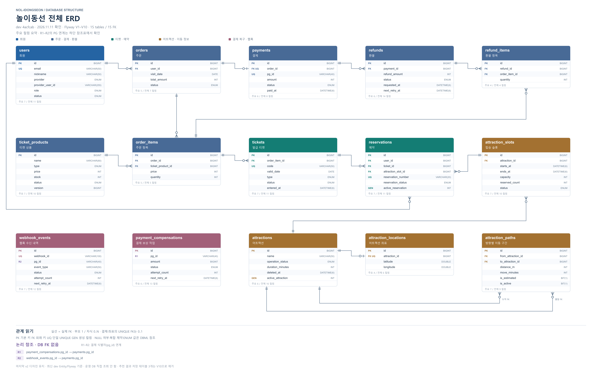

# API 명세서

현재 저장소 코드의 HTTP 요청·응답 계약을 도메인별로 정리한다. **인증·CSRF·응답 envelope·시간 형식은 [공통 규칙](common.md)을 먼저 확인한다.**

- 작성 기준: 2026-11-12, 로컬 dev 기반 코드 `a737e62f` → `docs/api-specification`.
- 범위: 업무 Controller의 **63개 endpoint**, OAuth2 redirect 경로, 운영 endpoint의 접근·응답 구분.
- 문서 검증: Controller·DTO·Service·Repository·enum·SecurityConfig·예외 처리와 정적 대조. API 호출·빌드·테스트·운영 배포 확인은 수행하지 않음.
- sources 참고 자료는 읽기 전용으로 확인했다. 현재 코드와 원본 정책의 차이는 [공통 규칙](common.md#문서와-코드의-차이확인할-정책)에 표시했다. ERD 이미지의 모든 필드를 검토한 문서가 아니다.

## ERD

## 도메인별 문서

| 문서 | 범위 |
|---|---|
| [공통 규칙](common.md) | 인증, CSRF, 쿠키, 응답, 오류, pagination, 시간·정책 차이 |
| [Auth](auth.md) | CSRF, 로그인·재발급·로그아웃, 소셜 코드 교환 |
| [User](users.md) | 가입·본인 정보·비밀번호·탈퇴, 관리자 회원 관리 |
| [TicketProduct](ticket-products.md) | 판매 상품 조회·관리자 CRUD·version |
| [Ticket](tickets.md) | 내 입장권 조회, 관리자 입장 처리 |
| [Reservation](reservations.md) | 예약 생성·조회·취소, 관리자 취소·완료·노쇼 |
| [Attraction](attractions.md) | 공개 목록·상세, 질문, 관리자 정보·상태 관리 |
| [AttractionSlot](attraction-slots.md) | 날짜별 조회, 관리자 슬롯 생성·수정·삭제 |
| [Order](orders.md) | 내 주문·관리자 대리 주문·취소 |
| [Payment](payments.md) | 결제 조회·승인, PortOne 설정·웹훅 |
| [Refund](refunds.md) | 본인·관리자 전체·부분 환불 |
| [RouteRecommendation](route-recommendations.md) | 위치 기반 추천·추천 가능 목록·일괄 예약 |

`admin-orders.md`는 기존 링크 호환 안내로 유지한다. 관리자 주문의 계약은 `orders.md` 한 곳에서 관리한다.

## 전체 endpoint 목록

| Method | 경로 | 기능 | 접근 | 성공 HTTP |
|---|---|---|---|---|
| GET | [`/api/auth/csrf`](auth.md) | CSRF 토큰 조회 | 공개 | 200 |
| POST | [`/api/auth/login`](auth.md) | 이메일 로그인 | 공개 + CSRF | 200 |
| POST | [`/api/auth/oauth2/exchange`](auth.md) | 소셜 로그인 코드 교환 | 공개 + CSRF | 200 |
| POST | [`/api/auth/refresh`](auth.md) | Access Token 재발급 | Refresh Token 쿠키 + CSRF | 200 |
| POST | [`/api/auth/logout`](auth.md) | 로그아웃 | 로그인 + Refresh Token 쿠키 + CSRF | 200 |
| POST | [`/api/users/signup`](users.md) | 회원가입 | 공개 + CSRF | 201 |
| GET | [`/api/users/me`](users.md) | 내 정보 조회 | 로그인 | 200 |
| PATCH | [`/api/users/me`](users.md) | 닉네임 수정 | 로그인 | 200 |
| PATCH | [`/api/users/me/password`](users.md) | 비밀번호 변경 | 로그인 | 200 |
| DELETE | [`/api/users/me`](users.md) | 회원 탈퇴 | 로그인 | 200 |
| GET | [`/api/admin/users`](users.md) | 회원 목록 | ADMIN | 200 |
| GET | [`/api/admin/users/{userId}`](users.md) | 회원 상세 | ADMIN | 200 |
| PATCH | [`/api/admin/users/{userId}/status`](users.md) | 회원 상태 변경 | ADMIN | 200 |
| GET | [`/api/ticket-products`](ticket-products.md) | 상품 목록 | 로그인 | 200 |
| GET | [`/api/ticket-products/{ticketProductId}`](ticket-products.md) | 상품 상세 | 로그인 | 200 |
| POST | [`/api/admin/ticket-products`](ticket-products.md) | 상품 등록 | ADMIN | 201 |
| PUT | [`/api/admin/ticket-products/{ticketProductId}`](ticket-products.md) | 상품 수정 | ADMIN | 200 |
| DELETE | [`/api/admin/ticket-products/{ticketProductId}`](ticket-products.md) | 상품 삭제 | ADMIN | 200 |
| GET | [`/api/tickets/me`](tickets.md) | 내 티켓 목록 | 로그인 | 200 |
| GET | [`/api/tickets/{ticketId}`](tickets.md) | 내 티켓 상세 | 로그인 | 200 |
| POST | [`/api/admin/tickets/entry`](tickets.md) | 입장 처리 | ADMIN | 200 |
| POST | [`/api/reservations`](reservations.md) | 예약 생성 | 로그인 | 201 |
| GET | [`/api/reservations/me`](reservations.md) | 내 예약 목록 | 로그인 | 200 |
| GET | [`/api/reservations/{reservationId}`](reservations.md) | 내 예약 상세 | 로그인 | 200 |
| PATCH | [`/api/reservations/{reservationId}/cancel`](reservations.md) | 내 예약 취소 | 로그인 | 200 |
| GET | [`/api/admin/reservations`](reservations.md) | 전체 예약 목록 | ADMIN | 200 |
| GET | [`/api/admin/reservations/{reservationId}`](reservations.md) | 예약 상세 | ADMIN | 200 |
| PATCH | [`/api/admin/reservations/{reservationId}/cancel`](reservations.md) | 예약 강제 취소 | ADMIN | 200 |
| PATCH | [`/api/admin/reservations/{reservationId}/status`](reservations.md) | 완료·노쇼 처리 | ADMIN | 200 |
| GET | [`/api/attractions`](attractions.md) | 어트랙션 목록 | 공개 | 200 |
| GET | [`/api/attractions/{attractionId}`](attractions.md) | 어트랙션 상세 | 공개 | 200 |
| POST | [`/api/attractions/questions`](attractions.md) | 어트랙션 질문 | 로그인 | 200 |
| POST | [`/api/admin/attractions`](attractions.md) | 어트랙션 등록 | ADMIN | 201 |
| PATCH | [`/api/admin/attractions/{attractionId}`](attractions.md) | 일반 정보 수정 | ADMIN | 200 |
| PATCH | [`/api/admin/attractions/{attractionId}/status`](attractions.md) | 운영 상태 변경 | ADMIN | 200 |
| DELETE | [`/api/admin/attractions/{attractionId}`](attractions.md) | 어트랙션 삭제 | ADMIN | 200 |
| GET | [`/api/attractions/{attractionId}/slots`](attraction-slots.md) | 날짜별 슬롯 조회 | 로그인 | 200 |
| POST | [`/api/admin/attractions/{attractionId}/slots`](attraction-slots.md) | 슬롯 등록 | ADMIN | 201 |
| GET | [`/api/admin/attractions/{attractionId}/slots`](attraction-slots.md) | 관리자 날짜별 슬롯 조회 | ADMIN | 200 |
| PATCH | [`/api/admin/slots/{slotId}/time`](attraction-slots.md) | 슬롯 시간 변경 | ADMIN | 200 |
| PATCH | [`/api/admin/slots/{slotId}/capacity`](attraction-slots.md) | 슬롯 정원 변경 | ADMIN | 200 |
| PATCH | [`/api/admin/slots/{slotId}/status`](attraction-slots.md) | 슬롯 상태 변경 | ADMIN | 200 |
| DELETE | [`/api/admin/slots/{slotId}`](attraction-slots.md) | 슬롯 삭제 | ADMIN | 200 |
| POST | [`/api/orders`](orders.md) | 주문 생성 | 로그인 | 201 |
| GET | [`/api/orders/me`](orders.md) | 내 주문 목록 | 로그인 | 200 |
| GET | [`/api/orders/{orderId}`](orders.md) | 내 주문 상세 | 로그인 | 200 |
| POST | [`/api/orders/{orderId}/cancel`](orders.md) | 주문 취소 | 로그인 | 200 |
| GET | [`/api/admin/orders`](orders.md) | 전체 주문 목록 | ADMIN | 200 |
| GET | [`/api/admin/orders/{orderId}`](orders.md) | 주문 상세 | ADMIN | 200 |
| POST | [`/api/admin/orders`](orders.md) | 관리자 대리 주문 | ADMIN | 201 |
| POST | [`/api/admin/orders/{orderId}/cancel`](orders.md) | 관리자 주문 취소 | ADMIN | 200 |
| GET | [`/api/payments`](payments.md) | 내 결제 목록 | 로그인 | 200 |
| GET | [`/api/payments/{paymentId}`](payments.md) | 내 결제 상세 | 로그인 | 200 |
| POST | [`/api/payments/{pgId}/confirm`](payments.md) | 결제 승인 확인 | 로그인 | 200 |
| GET | [`/api/config/portone`](payments.md) | PortOne 프론트 설정 | 로그인 | 200 |
| POST | [`/api/payments/webhooks/portone`](payments.md) | PortOne 웹훅 수신 | PG 서명 | 200 |
| POST | [`/api/payments/{pgId}/refunds`](refunds.md) | 내 결제 전체 환불 | 로그인 | 200 |
| POST | [`/api/payments/{pgId}/refunds/partial`](refunds.md) | 내 결제 부분 환불 | 로그인 | 200 |
| POST | [`/api/admin/payments/{pgId}/refunds`](refunds.md) | 관리자 전체 강제 환불 | ADMIN | 200 |
| POST | [`/api/admin/payments/{pgId}/refunds/partial`](refunds.md) | 관리자 부분 강제 환불 | ADMIN | 200 |
| POST | [`/api/route-recommendations`](route-recommendations.md) | 경로 추천 생성 | 로그인 | 201 / 200 |
| POST | [`/api/route-recommendations/{recommendationId}/reservations`](route-recommendations.md) | 추천 경로 일괄 예약 | 로그인 | 201 |
| GET | [`/api/route-recommendations/attractions`](route-recommendations.md) | 추천 가능 어트랙션 | 로그인 | 200 |

## 사용하는 순서

1. CSRF 토큰 조회 → 회원가입 또는 로그인 → Access Token과 Refresh Token 쿠키 확보.
2. 상품 조회 → 주문 생성 → 프론트 PG 결제 → 서버 승인 확인 → 티켓 조회.
3. 관리자가 입장 처리한 IN_USE 티켓으로 슬롯 예약 또는 추천·일괄 예약.
4. 주문 취소(PENDING), 예약 취소, 결제 환불을 서로 다른 업무로 처리한다.

## 문서 유지 규칙

- API 변경 PR에서 해당 도메인 명세서를 함께 갱신한다. endpoint 추가·삭제 시 이 목록도 수정한다.
- 공통 인증·오류·응답 규칙은 common.md에서 관리하고 도메인에는 예외만 작성한다.
- DTO 필드명·필수 여부·enum·HTTP 상태·권한·시간 경계·pagination 기본값을 함께 확인한다.
- Controller에 없는 API를 요구사항만으로 구현된 것처럼 쓰지 않는다.
- 예시의 ID·날짜·토큰은 설명용이다. 실제 비밀값·쿠키·JWT를 문서에 넣지 않는다.
- 현재 코드와 정책 문서가 충돌하면 차이를 남기고 팀에서 확인한다. 이 명세서 작성으로 정책이 자동 변경된 것은 아니다.
